# Hi, I'm Kevin 👋

Staff Firmware Engineer at **SimpliSafe**, building firmware for the camera lineup: computer vision
pipelines, live monitoring features and the platform underneath them. Before that I spent over seven
years at **Motorola Solutions** working on secure, mission-critical communications: VPN and OpenSSL
cryptography, push-to-talk over LTE, and embedded MOTOTRBO radio repeaters.

- 📜 Six US patents in camera technology
- 🎓 B.S. Computer Science, University of Illinois at Chicago

## 💻 Familiar tools and technologies

<!-- skills:start -->
<!-- Generated from skills.toml by `uv run python -m readme_gen`. Do not edit. -->
<table>
  <tr>
    <td align="center">
       C
    </td>
    <td align="center">
      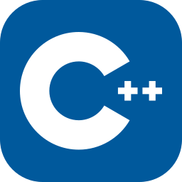 C++
    </td>
    <td align="center">
      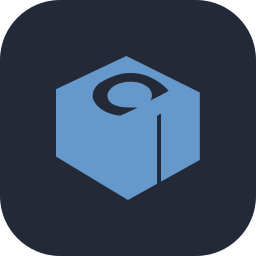 Conan
    </td>
    <td align="center">
       Python
    </td>
    <td align="center">
       Linux
    </td>
    <td align="center">
      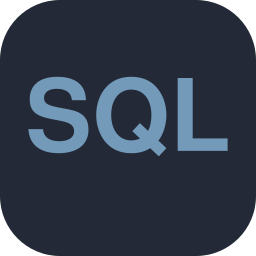 SQL
    </td>
    <td align="center">
       YAML
    </td>
  </tr>
  <tr>
    <td align="center">
      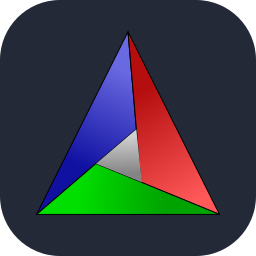 CMake
    </td>
    <td align="center">
       Docker
    </td>
    <td align="center">
       MkDocs
    </td>
    <td align="center">
       Mermaid
    </td>
    <td align="center">
       PlantUML
    </td>
    <td align="center">
      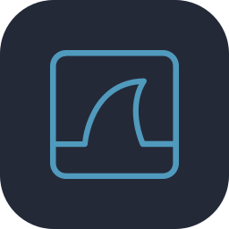 Wireshark
    </td>
    <td align="center">
      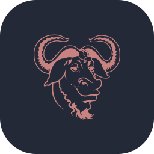 GDB
    </td>
    <td align="center">
       Claude Code
    </td>
  </tr>
  <tr>
    <td align="center">
      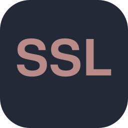 OpenSSL
    </td>
    <td align="center">
       WebRTC
    </td>
    <td align="center">
      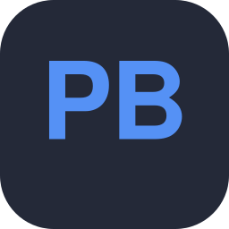 Protobuf
    </td>
    <td align="center">
       Boost
    </td>
    <td align="center">
       gtest
    </td>
    <td align="center">
       gcov
    </td>
    <td align="center">
      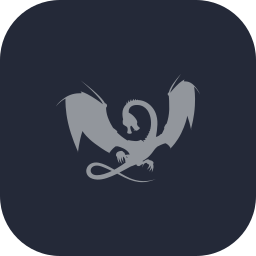 ASan
    </td>
    <td align="center">
      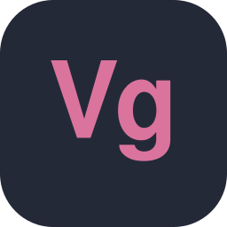 Valgrind
    </td>
  </tr>
  <tr>
    <td align="center">
      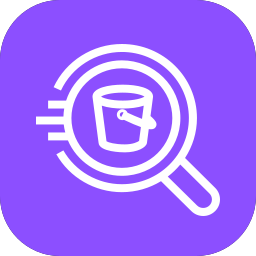 AWS Athena
    </td>
    <td align="center">
       AWS KVS
    </td>
    <td align="center">
       AWS S3
    </td>
    <td align="center">
      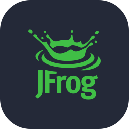 Artifactory
    </td>
    <td align="center">
       Grafana
    </td>
    <td align="center">
       GitHub Actions
    </td>
    <td align="center">
      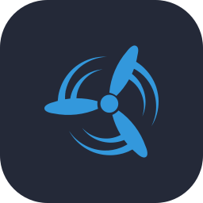 Concourse
    </td>
    <td align="center">
       GoCD
    </td>
  </tr>
</table>
<!-- skills:end -->
